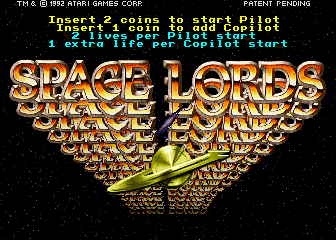
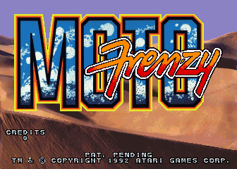
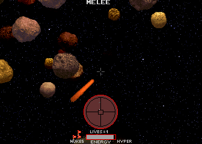
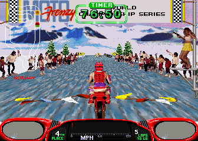

# Atari GX2 for MiSTer

MAME's `atari/atarigx2.cpp` driver, Atari Games' 1992 GX2 board (68EC020 at 14.318 MHz; JSA IIIs sound board: 6502 at
1.79 MHz, YM2151, two OKI6295; a 128 x 64 playfield of 8 x 8 6 bpp tiles, a 64 x 32 alphanumerics layer, Atari's RLE
motion objects with 5-7 MB of graphics, the XGA protection FPGA, an ADC0809 for the controls and a 2816 EEPROM), for the
MiSTer FPGA platform:

| Game | Sets | MRA |
|---|---|---|
| Space Lords (1992) | `spclords` (rev C), `spclordsb` (rev B), `spclordsa` (rev A), `spclordsg` (rev A, German) | `mra/Space Lords (rev C).mra`, the others in `mra/_alternatives/_Space Lords/` |
| Moto Frenzy (1992) | `motofren`, `motofrenmd` (Mini Deluxe), `motofrenft`, `motofrenfta` (field tests), `motofrenmf` | `mra/Moto Frenzy.mra`, the others in `mra/_alternatives/_Moto Frenzy/` |

Road Riot's Revenge (`rrreveng`, the third GX2 game) does not run in MAME 0.289 (its protection is not emulated) and is not
included. The cabinets' network boards (DSPCOM / Clarn) are not emulated in MAME either: one cabinet only.

Written for MiSTer from MAME 0.289's driver on the Primal Rage core (MiSTer-devel/Arcade-PrimalRage_MiSTer, Atari GT: the
same board family; its 68EC020 bus, RLE object renderer, tilemap engine, DDR3 fast load and NVRAM are the base here,
`rtl/UPSTREAM.md`), with the JSA IIIs written from MAME's `atarijsa.cpp` (the 6502 wiring after the Atari System 1 core).
The 68EC020 is TG68K.C (Tobias Gubener), the 6502 T65, the YM2151 [jt51](https://github.com/jotego/jt51) and the OKIs
[jt6295](https://github.com/jotego/jt6295) (Jose Tejada), the CRT Adjust page rmonic79's
[MiSTer-CRT-Adjust](https://github.com/rmonic79/MiSTer-CRT-Adjust) (`modules/VENDOR.md`). No ROMs are in this repository (the
pictures below are MAME screenshots); you supply your own MAME romset.

| Space Lords | Moto Frenzy |
|---|---|
|  |  |
|  |  |

These pictures come from MAME 0.289 (`tools/capture.py`): the title screens from attract mode, the others from a game started
with coins and Start (Space Lords firing the laser through an asteroid field, Moto Frenzy's Norway race).

## Status

**Tested on a real MiSTer** by the repository owner, on a CRT (the analog output) and on a RetroTINK 4K (direct video): both
games play with MAME's picture and sound, the controls and the OSD options (20261031b). The earlier builds' tests found the
music cutting out (the sound board's timing constraints, its command interrupt, and Moto Frenzy's sound watchdog, which led to
the CPU Speed option), Moto Frenzy's d-pad steering at half range, its service menu buttons unmapped, and a button name too
long for Main_MiSTer's Define Buttons page: all fixed by 20261031b. 20261101 adds one fix checked on the bench: Moto Frenzy's motion
objects are drawn from the object RAM as it was when the draw began, as in MAME (before, a few objects, most likely the
crowd's animation, could show a frame early).

What was checked besides, in simulation and in the Quartus tool flow, against MAME 0.289 (details and numbers in
`docs/status.md`):

* The ROM path: the nine sets' images assembled from the MRAs are byte-identical to those built from MAME's ROM tables.
* The whole machine from reset: Space Lords' boot colour test pixel-identical to MAME's; both attract modes through MAME's
  sequence (Space Lords' tutorial, Moto Frenzy's race in step with MAME's at its steady 30 Hz); Moto Frenzy's test menu
  pixel-identical.
* The sound board alone replaying MAME's logged commands of a 45 s Moto Frenzy session: no command lost, the envelope against
  MAME's recording correlating 0.94 / 0.90.
* Quartus Prime Lite 17.0: timing met on every clock, every RAM built at its declared depth.

Known differences: in Moto Frenzy's race the YM2151's engine sound is ~8 dB quieter against the samples than in MAME. Road
Riot's Revenge and the cabinets' network link are not in MAME and not here.

## Install

1. Unzip the release zip over the root of the SD card, or put `releases/atarigx2_YYYYMMDD.rbf` in `/media/fat/_Arcade/cores/`
   and the MRAs of `mra/` in `/media/fat/_Arcade/` (`mra/_alternatives` in `/media/fat/_Arcade/_alternatives`). Keep the RBF's
   `atarigx2_` name and date: MiSTer finds the core by the MRA's `<rbf>` name plus the date. Use the MRAs of the same release as
   the RBF, and delete older `atarigx2_*.rbf` files.
2. Your MAME 0.289 romset in `/media/fat/games/mame/`: `spclords.zip`, `motofren.zip` (merged sets: the clones are inside).
3. Start the game from the Arcade menu. With a recent Main_MiSTer the ROM loads fast (the MRA's `address=` makes
   Main_MiSTer copy the image into the DDR3, the core replays it from there).

An SDRAM module is required (32 MB or larger).

## Controls

Only the buttons the games read are mapped; the MRA names them.

**Space Lords** (two players, each a flight yoke): Laser, Nuke, Throttle Fwd, Throttle Rev, Rear View (player 1), Start
(player 1: Hyperspace; player 2: Cloak), Coin.

**Moto Frenzy** (one player, handlebars and a twist-grip throttle): Fire (also Start), Throttle (button), Coin, and the
operator's buttons AUX1, AUX2, AUX3 (X, Y, R by default; "AUX1 (Service Menu)" etc. in the button names): the game
ignores them in play, but its test menu is driven by them alone.

## Service menu (game settings)

There are no DIP switches on this board: coinage, difficulty and the rest are in the game's EEPROM and are changed in its
test menu. Turn **Service Mode** on in the OSD: the game drops into the menu at once (if the core starts with it already on,
Moto Frenzy first runs its power-on screen tests, about 10 s of plain colour screens). Turn it off again to restart the game.
The settings are saved with the NVRAM (OSD **Save NVRAM**, or **Autosave NVRAM**).

| | Space Lords | Moto Frenzy |
|---|---|---|
| move | the flight stick | AUX1 up, AUX2 down |
| choose | Laser (the "Trigger") | AUX3 |
| in a page | as the page says: the Trigger is Laser, the Thumb button Nuke | AUX1 changes the highlighted setting, AUX2 the next setting, AUX3 saves and goes back |

The OSD's **Controls** page picks where each analog control comes from, so the games play on a d-pad, an analog pad, a
paddle / spinner or a mouse:

| Option | Settings |
|---|---|
| Flight Stick (Space Lords) | Auto (whichever was used last: the left stick once it is pushed, the d-pad once it is pressed), D-Pad, Left Stick, Right Stick, Mouse (player 1) |
| Stick Y (Space Lords) | Normal, Inverted |
| Throttle (Space Lords) | Buttons, Buttons + Right Stick Y |
| Swap Players (Space Lords) | the two pads change places |
| Steering (Moto Frenzy) | Auto (as the Flight Stick), D-Pad, Left Stick, Right Stick, Paddle, Spinner, Mouse |
| Throttle (Moto Frenzy) | Button, Button (ramp), Left Stick Up, Right Stick Up, Right Stick Down, D-Pad Up |
| Steering Range (Moto Frenzy) | Full (MAME: the handlebars' whole travel), 75 %, 50 % |
| Steering (Moto Frenzy) | Normal, Inverted |
| D-Pad Speed | MAME (the analog value moves as MAME's keys move it: Moto Frenzy's handlebars reach full lock in 0.4 s), Slow, Fast, Instant |
| D-Pad Release | Return to Centre (MAME: at the D-Pad Speed), Snap to Centre (at once), Hold |
| Stick Dead Zone | None, 6 %, 12 %, 18 % |
| Stick Sensitivity | 100 %, 75 %, 125 %, 150 % |

Moto Frenzy's race select (STEER TO SELECT YOUR RACE) keeps scrolling while the handlebars are off centre, even a
little (in MAME too): with MAME's d-pad behaviour the handlebars take a moment to come back after the d-pad is let go
and the selection runs on. D-Pad Release: Snap to Centre stops it the moment the d-pad is let go.

## OSD

* **Aspect ratio**, **Scale** (Normal, V-Integer, HV-Integer, Narrower HV-Integer, HV-Integer+), **Scandoubler Fx**.
* **CRT Adjust** (H-Size, H-Position, V-Shift) for the 15 kHz output; off while the scandoubler is in use.
* **Service Mode**: the board's self-test switch, into the game's test and settings menu (above: Service menu).
* **Volume**: Normal, then 6 / 12 / 18 dB lower.
* **CPU Speed**: Auto (Paced for Moto Frenzy, Full for Space Lords), Full, Paced. The core's 68EC020 (TG68K with a ROM
  cache) runs 1.7 to 2.5 times as fast as MAME's. Moto Frenzy's sound watchdog needs it no faster than the board: at Full
  it resets the sound board every 6 s in the attract and the menus (the music cuts out). Space Lords keeps its CPU busy
  and runs best at Full.

## Build

Quartus Prime Lite 17.0: open `AtariGX2.qpf` or `quartus_sh --flow compile AtariGX2`. The MRAs are written by
`python tools/make_mra.py` (it reads MAME 0.289's romset and `src/mame/atari/atarigx2.cpp`; `tools/paths.py` says where) and
checked against `tools/gx2_rom.py`'s image. The two CPUs' Verilog is generated from their VHDL by
`tools/gen_vhdl_cores.sh` (GHDL).

## Simulation (Verilator 5 in WSL)

```
python tools/gx2_rom.py image spclords work/spclords.rom
sim/run.sh work/spclords.rom 0 300,600,900 work/sim/sl1 +pc        # the whole machine, frames as PPM
sim/run.sh work/motofren.rom 1 260 work/sim/mf +play +wdt +rate=2   # Moto Frenzy's sound watchdog timing, CPU paced
sim/run.sh work/motofren.rom 1 1800 work/sim/mf +rate=2 +vlog=1500  # the frame pacing in the attract race (tools/lua/gx2_vlog.lua: MAME's)
sim/run_jsa.sh work/motofren.rom work/snd/mf_play.log work/snd/mf.wav 45   # the JSA alone, replaying MAME's sound log
sim/run.sh work/motofren.rom 1 290,330,450 work/sim/mf_svc +rate=2 +test=100 +hold=7:300-304 +hold=8:420-424
                                            # the test switch on at frame 100, AUX2 (pad bit 7) and AUX3 (bit 8) pressed
python tools/capture.py motofren 290,330,450 work/cap/mf_svc --service 100 --hold AUX2:300-304 --hold AUX3:420-424
                                            # the same in MAME
```
`tools/lua/gx2_sndlog.lua` logs MAME's sound comm for `sim/run_jsa.sh`; `tools/cmp_audio.py` compares the bench's WAV
with MAME's `-wavwrite`.
`tools/lua/gx2_capture.lua` (MAME 0.289) saves MAME's frames and RAMs for the comparison.

## Release

`python tools/release.py` copies a finished build into `releases/` with its fitter / timing / RAM-depth reports;
`python tools/package.py` writes `dist/AtariGX2_MiSTer_<date>.zip` (the SD card structure: `_Arcade/*.mra`,
`_Arcade/_alternatives/`, `_Arcade/cores/*.rbf`; no ROMs).

## Credits

* **MAME** (the atarigx2, atarirle, atarijsa, atarixga drivers and devices by Aaron Giles, Morten Shearman Kirkegaard,
  Samuel Neves, Peter Wilhelmsen and others; BSD-3-Clause): the hardware knowledge and the oracle.
* **Nortido**: the Primal Rage core (GPL-3.0), this core's base.
* **d18c7db**: the Atari System 1 core (GPL-3.0), the 6502 sound wiring.
* **Tobias Gubener**: TG68K.C (LGPL-3.0). **T65**'s authors (the 6502).
* **Jose Tejada (jotego)**: jt51, jt6295 (GPL-3.0).
* **Umberto Parisi (rmonic79)**: MiSTer-CRT-Adjust (GPL-3.0-or-later).
* **The MiSTer framework** (Sorgelig and contributors).

## Licence

GPL-3.0-or-later (TG68K.C LGPL-3.0, jt51 / jt6295 GPL-3.0, MiSTer-CRT-Adjust GPL-3.0-or-later).
